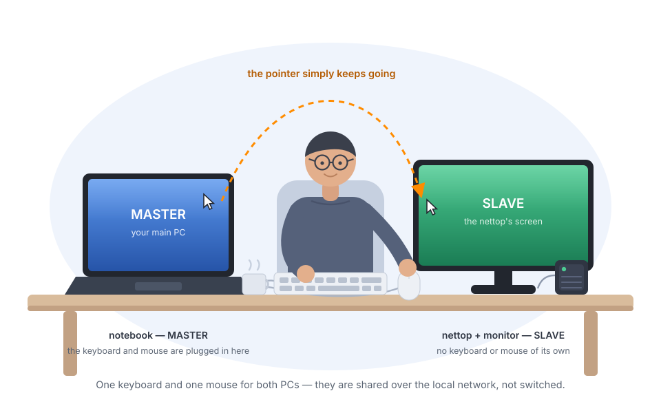
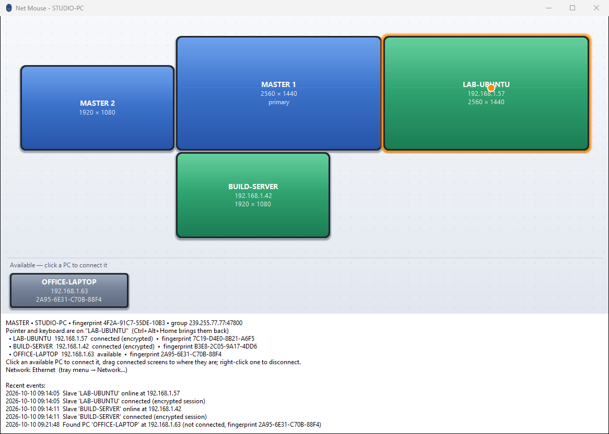
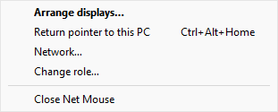
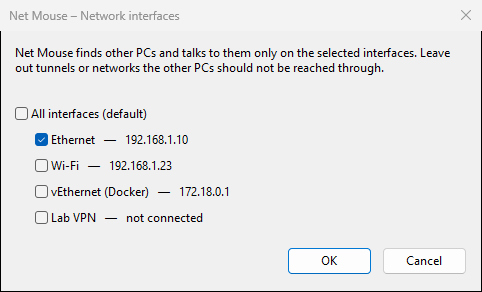
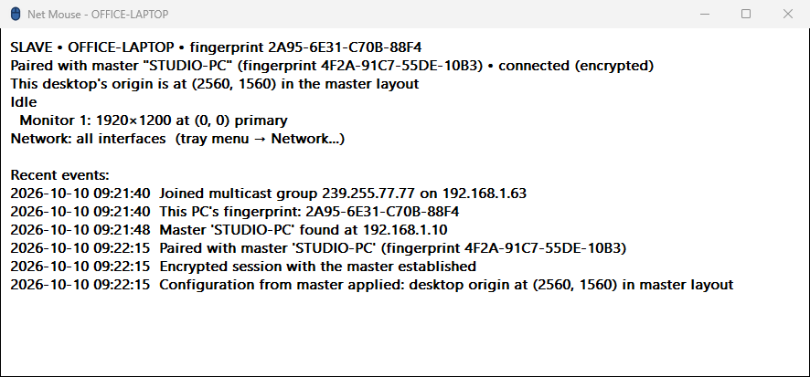
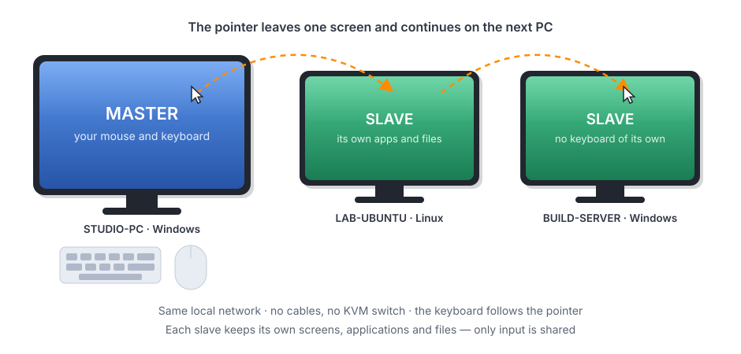
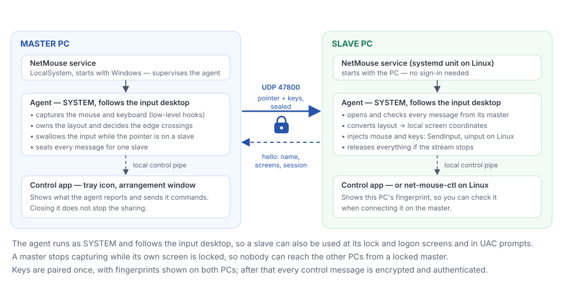
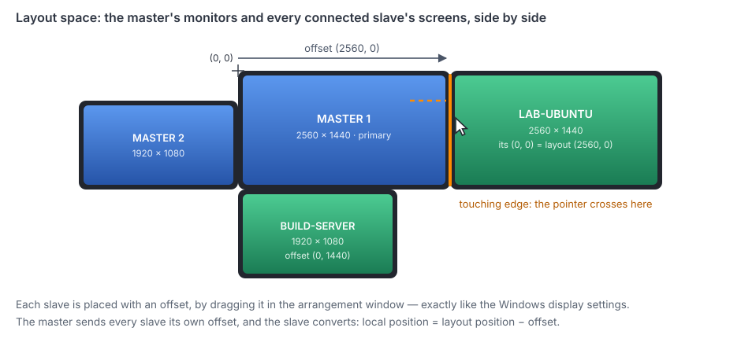

# net-mouse

Use the mouse and keyboard of one PC (the **master**) to control that PC and any number of other PCs
(**slaves**) on the same local network. Slave screens are arranged around the master's monitors, the same
way as in the Windows display settings. When the pointer leaves the master's monitors through an edge that
touches a slave screen, it continues on that slave, and the keyboard follows it.



It is a software KVM for input only: no video, no files, nothing installed on the PCs but Net Mouse
itself. Each PC keeps its own screens, applications and clipboard; only the pointer and the keystrokes
travel over the network.

* **Zero setup on the slaves:** they find the master by UDP multicast; the master places them and sends
  each its position.
* **Pairing on the master** with key fingerprints; all control traffic is **encrypted and authenticated**
  (X25519 + XChaCha20-Poly1305, see [Security](#security)).
* **Windows 10/11:** a Windows service (works at the lock and logon screens and in UAC prompts), a tray
  app with the arrangement editor, and an installer.
* **Linux (prototype):** one systemd service for both roles, working below the display server, so the
  same on X11 and Wayland (see [Linux](#linux-prototype)).

## Build

Requirements: Visual Studio 2022 (C++ workload) and CMake 3.20 or newer.

```
cmake -S . -B build -G "Visual Studio 17 2022" -A x64
cmake --build build --config Release
build\Release\nm_tests.exe
```

The result is a single `build\Release\net-mouse.exe` (static runtime) containing the service, the agent
and the control app. Install it with the installer below; the service is what runs Net Mouse.

### Installer

With [Inno Setup 6](https://jrsoftware.org/isinfo.php) installed:

```
cmake --build build --config Release --target installer
```

This produces `build\installer\net-mouse-setup-<version>.exe` from [installer/net-mouse.iss](installer/net-mouse.iss).
The setup:

* installs to `Program Files\Net Mouse` (requires administrator rights);
* installs and starts the **NetMouse Windows service** (see [Windows: service, agent and control
  app](#windows-service-agent-and-control-app)) and adds a Windows Firewall rule for the program;
* asks for the role of the PC: master, slave, or keep the current one / ask on first start;
* **Start automatically with Windows** (checked by default): the service starts with Windows and the
  control app (tray icon) at every sign-in. Unchecked, the service is set to start manually and no
  tray icon starts by itself. Upgrades keep the previous choice;
* moves the settings of earlier per-user versions (id, key, pairings, positions) to
  `%ProgramData%\NetMouse` on first install, and removes their per-user autostart task;
* on upgrade or uninstall stops the service and closes the control apps, then removes the service and
  the firewall rule. The settings in `%ProgramData%\NetMouse` are kept.

Unattended install, e.g. for a slave deployed over SSH:

```
net-mouse-setup-0.1.0.exe /VERYSILENT /SUPPRESSMSGBOXES /ROLE=slave
```

Startup is enabled by default; add `/MERGETASKS="!autostart"` for a manually started service.

### Windows: service, agent and control app

```
 NetMouse service (LocalSystem, session 0)
   └─ starts and watches ─► agent: net-mouse.exe --agent (SYSTEM, console session)
                               engine: network, encryption, hooks / SendInput
                               follows the input desktop (normal desktop, lock/logon screen, UAC)
                                   ▲  \\.\pipe\net-mouse-control (local only)
                                   │
                            control app: net-mouse.exe (each signed-in user)
                               tray icon, arrangement window, role, network, pairing
```

* A service runs in session 0 and cannot see or drive a desktop, so it supervises an **agent** in the
  session at the console: started as SYSTEM, restarted when it ends (backing off when it keeps
  failing), moved when the console session changes (user switch, logoff, remote desktop).
* The agent is the engine. As SYSTEM it can follow the **input desktop**, so a slave can be controlled at
  its lock and logon screens and in UAC prompts, and can operate administrator windows. A master stops
  capturing while its own screen is locked, so nobody can use the other PCs from a locked master.
* The **control app** only shows and changes settings, through the agent's local control pipe (the same
  requests as `net-mouse-ctl` on Linux). Closing it does not stop mouse and keyboard sharing.
* Settings, key and logs: `%ProgramData%\NetMouse` (`netmouse.ini`, `netmouse.key` readable only by
  SYSTEM and Administrators, `netmouse-agent.log`, `netmouse-service.log`).

## Usage



*The master's window: its own monitors in blue, connected PCs in green, an orange glow around the PC
that has the pointer right now, and PCs that were found but are not connected yet on the strip below.*

1. Install Net Mouse on every PC and choose the role: **Master** on the PC whose mouse you use, **Slave**
   on the others (in the installer, or on first start of the control app). Change it later from the
   tray menu (*Change role…*).
2. Each slave announces itself on the network. On the master, open *Arrange displays…* from the tray
   icon: the slave appears under **Available** with its name, IP and key **fingerprint**. Click it, check
   that the fingerprint matches the one shown in the slave's own Net Mouse window, and confirm. The
   slave is now **connected**: everything between the two is encrypted (see [Security](#security)).
   A slave trusts only the first master that connects it; *Forget master* in the slave's tray menu
   (Linux: `net-mouse-ctl forget-master`) releases it for another master.
3. Drag the green slave screens to where the PCs physically stand. Edges snap together, and the pointer
   crosses only where screens touch. Right-click a slave screen to disconnect it.
   If a PC has several networks (VPNs, tunnels), choose the ones Net Mouse may use with *Network…* in
   the tray menu.
4. The control app runs minimized in the notification area (system tray). The mouse icon is blue when idle
   and turns orange while the pointer is on a slave (on a slave: while it is being controlled). Its
   tooltip shows the current state. Click the icon to open the window. Minimizing or closing the window
   hides it to the tray again, and starting the app a second time opens the running instance. On
   Windows 11 new tray icons go to the overflow area; drag the icon onto the taskbar to keep it visible.
5. Move the pointer over the edge. While it is on a slave, the master's cursor is hidden and the
   master's clicks, wheel and **keyboard** go to that slave. Keys are sent as physical key positions,
   so the slave's own keyboard layout applies. A key's release always goes where its press went, so
   nothing sticks when the pointer moves between PCs. Ctrl+Alt+Del and Win+L stay on the master.

Everything else is in the tray menu, and *Network…* picks the networks Net Mouse may use — leave out
tunnels and VPNs that the other PCs should not be reached through:




A slave needs no attention of its own; its window only reports what is going on, and shows the
fingerprint to check while connecting it on the master:



**Emergency return:** **Ctrl+Alt+Home** or the tray item *Return pointer to this PC* brings the pointer
back to the master at once. A slave that disappears from the network also returns the pointer
automatically.

The installer adds a Windows Firewall rule for `net-mouse.exe` (UDP, inbound). Without the installer:

```
netsh advfirewall firewall add rule name="Net Mouse" dir=in action=allow protocol=UDP localport=47800
```

### Command line

| Command | Meaning |
|---|---|
| `net-mouse.exe` | control app (tray icon); `--show` opens the window at start, `--pipe NAME` talks to another agent |
| `net-mouse.exe --quit` | close the Net Mouse windows in this session |
| `net-mouse.exe --service` | the service itself (started by Windows) |
| `net-mouse.exe --agent` | the engine (started by the service); `--config FILE`, `--pipe NAME`, `--role master\|slave`, `--dry-run` (slave: log input instead of injecting it) |

Testing without the service: run `net-mouse.exe --agent --config test.ini --pipe test --dry-run` and
`net-mouse.exe --pipe test --show`.

### Settings (`netmouse.ini`)

| Key | Default | |
|---|---|---|
| `role` | — | `master` or `slave` |
| `id` | random | persistent identity of this PC |
| `name` | computer name | |
| `group`, `port` | `239.255.77.77`, `47800` | multicast group and UDP port (must match on all PCs) |
| `interfaces` | empty | network interfaces to use, by name or IPv4 address (`Ethernet 5, 10.10.69.150`); empty = all. Set it with *Network…* in the tray menu; takes effect immediately |
| `hide_cursor` | `1` | master: hide the local cursor while the pointer is on a slave |
| `slave.<id>.x/.y`, `slave.<id>.key` | | master: saved position and pinned public key of each connected slave |
| `master_id`, `master_key`, `offset_x/_y`, `config_version` | | slave: the paired master and the last configuration |

The settings are in `%ProgramData%\NetMouse\netmouse.ini`. This PC's private key is in `netmouse.key`
next to it; it never leaves the PC. Logs: `netmouse-agent.log` and `netmouse-service.log` in the same folder.

## How it works



Every PC runs the same program in one of two roles. The master owns the pointer and decides where it
is; a slave only receives it and plays it back on its own screens.



* **Layout space** = the master's virtual-desktop coordinates in physical pixels. Every slave's monitors
  are placed in it at an *offset* chosen in the arrangement dialog. The slave receives that offset and
  converts with `local = layout_position − offset`.

  

* **Capture (master):** a low-level mouse hook watches the cursor. When it touches an edge pixel and
  the neighbouring layout pixel belongs to a slave, the master switches to *remote* mode. The real cursor
  is parked at the centre of the primary monitor and hidden. Each hooked move is converted into a
  delta from the park point and applied to a virtual pointer. All mouse events are swallowed so the
  master doesn't react to them. When the virtual pointer moves back onto a master monitor, the real
  cursor is placed there and normal operation continues.
* **Keyboard (master):** a low-level keyboard hook; while the pointer is on a slave, keys are swallowed
  and sent to it. The emergency hotkey is detected by the engine itself, because Windows hotkeys cannot
  fire while keys are swallowed.
* **Injection (slave):** `SendInput` with absolute virtual-desktop coordinates, button, wheel and
  scan-code key events.
* Edge crossing is blocked while a button is held, so a drag never starts on one PC and ends on another.

No kernel driver is needed for this: low-level hooks and `SendInput`, run by the agent as SYSTEM on
the input desktop, also reach the lock and logon screens and UAC prompts.

### Protocol

UDP port `47800`, protocol version 2. Discovery (master announcements, slave hellos) goes to the
multicast group `239.255.77.77` with TTL 1; it is also sent straight (unicast) to the PCs already heard,
and everything for one slave goes to it by unicast only. Wi-Fi access points and IGMP-snooping switches
sometimes stop forwarding a group to a PC, typically after it slept, and over Wi-Fi unicast is also
acknowledged and retried. A slave that hears no master renews its group membership every 30 s.
Every datagram starts with a readable
header: magic `NMSE`, version, type, 64-bit sender id and a sequence number (little-endian). See
[src/core/protocol.h](src/core/protocol.h).

Only discovery is plain text. Everything that controls a PC travels in a **sealed** envelope: the
header plus the target id, key kind and a random 24-byte nonce stay readable for routing but are
authenticated; the message itself is encrypted (XChaCha20-Poly1305). A control message that arrives
unencrypted is dropped.

| Message | Direction | Sealed | When |
|---|---|---|---|
| `MasterAnnounce` (name, public key) | master → all | no | every second |
| `SlaveHello` (name, monitors, public key, paired master, config version, session nonce + id, MAC) | slave → all | no (MAC) | every second, and as an acknowledgement |
| `SessionInit` (master nonce, echo of the slave's nonce) | master → slave | pair key | to (re)start a session |
| `SlaveConfig` (version, offset) | master → slave | session key | until the slave's hello acknowledges that version |
| `Pointer` (layout position, buttons, wheel, held keys) | master → slave | session key | every mouse event, plus a 100 ms heartbeat |
| `Key` (key code, press/release/repeat, held keys) | master → slave | session key | every key event |
| `Leave` | master → slave | session key | pointer left that slave |

Loss handling: each `Pointer` carries the *complete* button state and the set of keys held for that
slave, and each `Key` carries the held keys too, so a lost press or release is repaired by the next
packet. Button, wheel and key packets are sent twice and the slave drops duplicates by sequence
number. A slave releases all buttons and keys if the stream stops for 1.5 s. A master treats a slave as
gone after 3.5 s without a hello.

### Security

* **Identity:** every PC creates an X25519 key pair on first start (`netmouse.key`). The public key and a
  short fingerprint of it are part of discovery.
* **Pairing** happens on the master: a discovered PC is only *available* until the user connects it,
  which pins its public key. The slave pins the master's key at the same moment and refuses other
  masters until *Forget master*. A PC that later announces a different key is flagged and not trusted.
* **Pair key:** master and slave each compute `BLAKE2b(X25519(own secret, peer public) ‖ master pub ‖ slave pub)`:
  only those two PCs can derive it. Hellos from a paired slave carry a MAC with it.
* **Sessions:** on every (re)start of either side the master sends a `SessionInit`, sealed with the pair
  key, that echoes the slave's current random nonce. The session key is derived from the pair key and
  both nonces; the slave renews its nonce after each handshake. Recorded traffic or an old handshake
  therefore never works again, and within a session the sequence number must always increase.
* **Library:** [Monocypher](https://monocypher.org) 4.0.2 (`third_party/monocypher`, compiled in);
  random numbers from the OS (`BCryptGenRandom` / `getrandom`).
* Discovery is not secret: anyone on the LAN can see which PCs run Net Mouse, their names, screen sizes
  and public keys. Check the fingerprint when connecting a PC if the network is not trusted.

## Linux (prototype)

`net-mouse-daemon` is one service for both roles. It works at the kernel input layer, so it behaves the
same on X11, any Wayland compositor (GNOME, KDE, sway, Hyprland, ...) and the text console:

* **Slave:** creates a *uinput* virtual **absolute** pointer, like a VM's USB tablet. The display server
  maps its range onto the whole desktop, so the master's position lands exactly where it should.
* **Master:** grabs the physical mice and keyboards exclusively through *evdev* (`EVIOCGRAB`) and owns
  the pointer position. Local input is passed back through its own virtual devices. When the pointer
  crosses an edge that touches a slave, mouse and keyboard go to the slave instead and the real cursor
  waits at the edge. If the daemon stops, the kernel releases the grabs and mouse and keyboard work
  normally again.
* The **monitor layout** comes from `monitors=` in the settings (recommended), or is detected from the
  DRM connectors in `/sys/class/drm` (preferred mode, placed left to right).

### Install from source

Needs `cmake` 3.20+, `g++` 10+ (C++20) and the kernel headers; the settings window also needs
`python3-tk`. On Debian/Ubuntu: `sudo apt install cmake g++ python3-tk`.

```
git clone https://github.com/snedosiekov/net-mouse.git
cd net-mouse && mkdir build && cd build
cmake ..
make
sudo make install ROLE=slave          # or ROLE=master
```

`make install` puts `net-mouse-daemon`, `net-mouse-ctl` and `net-mouse-gui` in `/usr/local/bin`,
installs `net-mouse.service` and a desktop entry, loads `uinput` (now and at boot), opens UDP 47800 in
ufw/firewalld, writes the role to `/etc/net-mouse/netmouse.ini`, and **enables and starts the
service**. It then runs at every boot and is restarted if it ever stops. Without `ROLE=` the role
stays as configured. On a first install the service then waits for `net-mouse-ctl role ...`.
`sudo make uninstall` stops and disables the service and removes the installed files (settings are kept).

### Command line: `net-mouse-ctl`

```
net-mouse-ctl role                   # show the role
sudo net-mouse-ctl role master       # change it (restarts the service)
net-mouse-ctl monitors               # configured and detected layout
sudo net-mouse-ctl monitors 2560x1440+0+0,1920x1080+2560+0     # or: auto
net-mouse-ctl status                 # service state + what the daemon sees (JSON)
net-mouse-ctl fingerprint            # this PC's key fingerprint (compare it when connecting)
sudo net-mouse-ctl forget-master     # slave: release it so another master can connect it
net-mouse-ctl interfaces             # network interfaces and which are in use
sudo net-mouse-ctl interfaces eno1   # use only eno1 (or: all); applied immediately
net-mouse-ctl logs                   # follow the journal
net-mouse-ctl gui                    # settings window
```

### Settings window: `net-mouse-gui`

Start it from the application menu (*Net Mouse*) or with `net-mouse-gui`. It talks to the service over
`/run/net-mouse/control.sock`:

* **master:** the same arrangement editor as on Windows. Discovered PCs are listed under *Available*:
  click one to connect it (compare the fingerprint). Drag the green slave screens next to the master's
  monitors; edges snap together, and the pointer crosses where screens touch. Right-click to disconnect.
* **This PC:** the monitor layout (*Detect* reads it from `xrandr`, *Auto* uses the DRM detection), the
  role, the network interfaces to use, and on a slave *Forget master*.

Anyone can view the status. Changes need root or membership in `sudo`, `wheel`, `admin` or `netmouse`.

### Settings (`/etc/net-mouse/netmouse.ini`)

In addition to the common ones:

| Key | Default | |
|---|---|---|
| `monitors` | detected | layout as `WxH+X+Y,...`; first entry is the primary monitor. Use the compositor's *logical* size when display scaling is on (a 3840×2160 screen at 200 % is `1920x1080+0+0`) |
| `pointer_speed` | `1.0` | master: speed multiplier for local movement |
| `pointer_accel` | `0.0` | master: simple speed-dependent acceleration (0 = flat) |

Diagnostics: `sudo net-mouse-daemon --list-devices` shows the detected monitors and mice.

Testing without hardware: `sudo python3 tests/linux_e2e.py build/net-mouse-daemon` creates a fake
mouse and keyboard with uinput and runs a master and a slave on a private port. It checks pairing,
edge crossing, clicks, wheel, keys, the emergency hotkey, the return to the master, interface
selection, the control socket and that forged unencrypted packets are ignored.

Prototype limitations:

* **Master:** touchpads are not grabbed. On a laptop master, using the touchpad moves the real cursor
  behind the daemon's back. Use a mouse, or run the laptop as a slave.
* **Master:** pointer acceleration is the daemon's own, not the desktop's setting. Tune it with
  `pointer_speed` / `pointer_accel`.
* **Multi-monitor slaves with mixed scaling:** how the compositor maps the absolute device can differ
  between compositors. Check that the pointer lands correctly at the edges.
* Displays are read at start-up. Changing them with `net-mouse-ctl monitors` or the settings window restarts
  the service automatically.

## Source layout

| Path | |
|---|---|
| `src/core/` | portable: geometry, protocol, crypto, keymap, layout math, config, JSON, log, UDP multicast (Winsock + BSD sockets) |
| `src/app/` | portable role engines (`MasterEngine`, `SlaveEngine`) and the control protocol (`control_handler`) |
| `src/platform/platform.h` | OS interfaces: displays, cursor, injector, input sink |
| `src/platform/win/` | Windows: monitor enumeration, LL hooks, `SendInput`, cursor hiding, input-desktop following, control pipe |
| `src/win/` | Windows service (`service_win.cpp`) and agent (`agent_win.cpp`) |
| `src/ui/win/` | Windows control app: role dialog, tray icon, status window, display-arrangement editor |
| `src/platform/linux/` | Linux: uinput virtual pointer, evdev capture, DRM/config monitor layout |
| `src/linux/` | Linux service (`net-mouse-daemon`), control socket, settings window (`gui/net-mouse-gui.py`) |
| `installer/`, `packaging/linux/`, `cmake/` | Inno Setup script; systemd unit, `net-mouse-ctl`, desktop entry, install/uninstall hooks |
| `tests/` | unit tests (protocol, crypto, layout, keymap, JSON, control protocol), master↔slave sessions incl. pairing and attacks over fake platform objects, Linux end-to-end test |
| `third_party/monocypher/` | Monocypher 4.0.2 (cryptography), compiled in |

## Limitations

* **Ctrl+Alt+Del** cannot be sent to a slave: Windows reserves it (the secure attention sequence).
  Lock and logon screens and UAC prompts on a slave can be used.
* Pointer speed is 1:1 in physical pixels. Screens with very different DPI feel different in size.
* Several masters may share a network (a warning is logged); each slave belongs to the master that
  connected it.
* No clipboard sharing yet.

## Roadmap

* **Linux, next steps:** a tray icon; reading the monitor layout from Wayland (`wl_output` /
  `xdg-output`) automatically; touchpad support on the master; .deb/.rpm packages.
* Clipboard sharing; key rotation for long-running sessions.
